# Del presupuesto al gasto: los ministerios de España (2017–2026)

¿Cuánto se presupuesta para cada ministerio, cuánto se gasta de verdad, con qué se paga y en qué se gasta? Este proyecto lo mide para los 22 ministerios con datos públicos, empezando por tres (Defensa, Interior y Agricultura) y añadiendo los demás a una comparativa común.

Es un **análisis de la ejecución presupuestaria con datos públicos**, no una auditoría: no tiene acceso a la contabilidad ni a los expedientes, que es lo que revisan la IGAE y el Tribunal de Cuentas.

Continúa el proyecto [Gasto de fin de ejercicio en la contratación de Defensa](https://github.com/DeLabFuente/defense-year-end-spending), que queda cerrado y sin cambios.

## Preguntas

1. **Presupuestado frente a gastado.** Créditos iniciales → modificaciones (créditos extraordinarios, suplementos, ampliaciones, transferencias, remanentes, generaciones) → créditos definitivos → obligaciones reconocidas → pagos. Por ministerio, capítulo y programa.
2. **Con qué se paga.** Los ministerios casi no tienen ingresos propios: se financian con el presupuesto general del Estado. Se muestra la financiación de sus organismos (transferencias del Estado, tasas, precios públicos, fondos europeos) y el peso del Mecanismo de Recuperación en cada ministerio.
3. **En qué se gasta.** Capítulos (personal, bienes y servicios, transferencias, inversiones), programas, contratación (PLACSP) y subvenciones (BDNS), siempre en agregado.

## Principios

- **Solo datos públicos**, con la fuente de cada cifra.
- **Incentivos, no personas.** Nada de nombres de personas, adjudicatarios ni beneficiarios: solo agregados por ministerio, organismo, capítulo o programa.
- **Una diferencia no es una irregularidad.** Que se gaste más o menos de lo presupuestado tiene explicaciones legítimas (prórroga del presupuesto, créditos extraordinarios, emergencias).
- **Mismas reglas para todos los ministerios**, con un modelo pensado para los 22 desde el principio.

## Estado — 14/11/2026

| Fase | Estado |
| --- | --- |
| 0. Fuentes, formatos y años | Hecha: fuentes de la IGAE (liquidación del Estado y de organismos, estadísticas mensuales), de la SEPG (presupuestos), de la PLACSP (contratación) y de la BDNS (subvenciones); viabilidad confirmada el 30/10/2026 |
| 1. Lectura de la liquidación (todas las secciones) y equivalencias de ministerios | Hecha: liquidación 2017-2024 y mensual de diciembre de 2025, 37 secciones, 2.589 controles de cuadre correctos. Ver [`datos/LEEME.md`](datos/LEEME.md) |
| 2. Ficha de Defensa, Interior y Agricultura | Hecha: [`fichas/defensa.md`](fichas/defensa.md), [`fichas/interior.md`](fichas/interior.md), [`fichas/agricultura.md`](fichas/agricultura.md). Estado y organismos 2017-2024 (más 2025 provisional del Estado), sin doble cómputo, Mecanismo de Recuperación 2021-2025 y contratación 2017-2025 |
| 3. Comparativa común de los 22 ministerios | Hecha: [`comparativa.md`](comparativa.md) (apartados 1 a 6) y [`preguntas.md`](preguntas.md) (apartados 7 a 17, desde el 14/11). Tamaño y ejecución 2024, presupuesto prorrogado 2024-2025, calendario de la prórroga (días por año y por Gobierno, con fecha del BOE), lo que no se gasta, composición, series, Mecanismo de Recuperación y contratación con niveles A/B/C. Revisada el 11/11 con las 22 fichas: líneas que explican la ejecución de cada ministerio, lo reconocido frente a lo pagado y la nota sobre el porcentaje acumulado del Mecanismo. En `preguntas.md`: Apartado 7 (11/11): respuesta a las catástrofes de 2020-2025 en todas las secciones. Apartado 8 (11/11): crédito del presupuesto frente a crédito creado durante el año. Apartado 9 (13/11): contratación frente a gasto. Apartado 10 (13/11): concentración del gasto por líneas. Apartado 11 (13/11): remanentes, crédito anulado y bajas. Apartados 12 y 13 (13/11): reconocido y sin pagar al cierre, y gasto sobre el crédito inicial. Apartados 14 a 17 (13-14/11): euros constantes, ministerio actual o de entonces, subvenciones según la BDNS y calendario mensual de ejecución de 2024 y 2025. Apartado 18 (15/11): transferencias a las comunidades autónomas (artículos 45 y 75) y su calendario de 2025 |
| 4. Informe en Power BI | Hecho: `powerbi/presupuesto_al_gasto.pbip`, 15 páginas (1 a 8: presupuesto, prórroga, Mecanismo, cierre y valor del dinero; 9 a 14: catástrofes, crédito nuevo y remanentes, inicial y pagado, contratación y gasto, subvenciones y calendario mensual; 15: método), con tema y paleta propios, generado por `scripts/15_informe_powerbi.py` (validado contra los esquemas oficiales con `scripts/15b_validar_informe.py`; revisado en Power BI Desktop el 14/11/2026; para abrirlo hay que apuntar el parámetro `RutaProyecto` a la carpeta del proyecto, ver `powerbi/MODELO.md`). Cada año muestra el ministerio de entonces, y los importes pueden pasarse a euros de 2025 (IPC, deflactor del PIB o del consumo público). Guía en [`powerbi/MODELO.md`](powerbi/MODELO.md) |
| 5. Fichas de los otros 19 ministerios | Hechas las 19: [`fichas/hacienda.md`](fichas/hacienda.md), [`fichas/transportes.md`](fichas/transportes.md), [`fichas/transicion_ecologica.md`](fichas/transicion_ecologica.md), [`fichas/ciencia.md`](fichas/ciencia.md), [`fichas/trabajo.md`](fichas/trabajo.md), [`fichas/inclusion.md`](fichas/inclusion.md), [`fichas/cultura.md`](fichas/cultura.md), [`fichas/presidencia_justicia.md`](fichas/presidencia_justicia.md), [`fichas/asuntos_exteriores.md`](fichas/asuntos_exteriores.md), [`fichas/economia.md`](fichas/economia.md), [`fichas/sanidad.md`](fichas/sanidad.md), [`fichas/industria.md`](fichas/industria.md), [`fichas/educacion.md`](fichas/educacion.md), [`fichas/politica_territorial.md`](fichas/politica_territorial.md), [`fichas/igualdad.md`](fichas/igualdad.md), [`fichas/transformacion_digital.md`](fichas/transformacion_digital.md), [`fichas/juventud_infancia.md`](fichas/juventud_infancia.md), [`fichas/vivienda.md`](fichas/vivienda.md) y [`fichas/derechos_sociales.md`](fichas/derechos_sociales.md) (las 8 últimas son de nivel C). Con las 3 de la fase 2 están las 22 fichas con el mismo modelo; pasada de coherencia hecha el 10/11 en lo comprobable (citas de línea que dicen «sin reconocer», avisos cruzados de perímetro, aviso de doble cómputo, nota del Mecanismo en las 22 fichas) |

## Lo más relevante (millones de euros)

<!-- tabla:ministerios -->
| Ministerio (ficha) | Obligaciones del Estado 2024 | 2025 (prov.) | Oblig. / iniciales 2024, % | Gasto de sus organismos 2024 | Gasto agregado 2024 | Contratación ordinaria 2024 | Mecanismo de Recuperación, obligaciones 2021-2025 | Contratación: nivel |
| --- | ---: | ---: | ---: | ---: | ---: | ---: | ---: | :---: |
| [Inclusión, Seguridad Social y Migraciones](fichas/inclusion.md) | 50.237 | 54.801 | 110,1 | 0 | 50.237 | 504 | 872 | B |
| [Trabajo y Economía Social](fichas/trabajo.md) | 676 | 636 | 141,9 | 30.260 | 30.381 | 74 | 2.387 | A |
| [Hacienda](fichas/hacienda.md) | 20.039 | 9.219 | 104,1 | 1.889 | 20.083 | 1.733 | 567 | A |
| [Defensa](fichas/defensa.md) | 14.986 | 18.806 | 116,8 | 1.140 | 16.055 | 2.509 | 588 | A |
| [Interior](fichas/interior.md) | 10.695 | 11.144 | 104,2 | 1.327 | 11.518 | 740 | 379 | A |
| [Transportes y Movilidad Sostenible](fichas/transportes.md) | 10.563 | 11.506 | 92,2 | 128 | 10.675 | 2.854 | 13.269 | A |
| [Transición Ecológica y el Reto Demográfico](fichas/transicion_ecologica.md) | 8.935 | 8.974 | 79,1 | 1.175 | 9.713 | 843 | 20.685 | A |
| [Agricultura, Pesca y Alimentación](fichas/agricultura.md) | 1.237 | 1.566 | 114,5 | 8.269 | 9.040 | 38 | 1.592 | C |
| [Transformación Digital y de la Función Pública](fichas/transformacion_digital.md) | 6.057 | 6.394 | 110,7 | 2.030 | 8.058 | 220 | 11.415 | C |
| [Industria y Turismo](fichas/industria.md) | 6.522 | 9.976 | 77,4 | 198 | 6.644 | 30 | 11.447 | C |
| [Derechos Sociales, Consumo y Agenda 2030](fichas/derechos_sociales.md) | 5.467 | 5.329 | 128,9 | 22 | 5.476 | 42 | 3.109 | C |
| [Educación, Formación Profesional y Deportes](fichas/educacion.md) | 5.071 | 4.725 | 75,3 | 299 | 5.106 | 55 | 4.517 | C |
| [Ciencia, Innovación y Universidades](fichas/ciencia.md) | 3.934 | 4.684 | 52,8 | 2.973 | 4.979 | 196 | 5.615 | A |
| [Economía, Comercio y Empresa](fichas/economia.md) | 5.096 | 5.022 | 203,1 | 3.342 | 4.970 | 46 | 16.647 | B |
| [Presidencia, Justicia y Relaciones con las Cortes](fichas/presidencia_justicia.md) | 2.631 | 2.791 | 105,7 | 314 | 2.829 | 104 | 456 | B |
| [Asuntos Exteriores, Unión Europea y Cooperación](fichas/asuntos_exteriores.md) | 1.703 | 1.819 | 87,7 | 794 | 1.794 | 68 | 155 | B |
| [Sanidad](fichas/sanidad.md) | 1.439 | 1.235 | 113,1 | 88 | 1.500 | 121 | 1.330 | B |
| [Vivienda y Agenda Urbana](fichas/vivienda.md) | 1.367 | 4.781 | 39,3 | 0 | 1.367 | 6 | 4.174 | C |
| [Cultura](fichas/cultura.md) | 993 | 1.039 | 95,1 | 560 | 982 | 128 | 770 | B |
| [Igualdad](fichas/igualdad.md) | 492 | 481 | 97,9 | 20 | 493 | 9 | 179 | C |
| [Política Territorial y Memoria Democrática](fichas/politica_territorial.md) | 465 | 2.259 | 113,0 | 0 | 465 | 47 | 336 | C |
| [Juventud e Infancia](fichas/juventud_infancia.md) | 212 | 297 | 132,0 | 47 | 247 | 2 | 99 | C |
| **22 ministerios** | 158.818 | 167.486 | 100,3 | 54.873 | 202.614 | 10.368 | 100.585 | |
<!-- /tabla -->

Ordenado por gasto agregado de 2024 (Estado más organismos, sin doble cómputo). 2025 es provisional y solo tiene el Estado. La contratación ordinaria son licitaciones sin programas especiales; la de Hacienda incluye las compras centralizadas de toda la AGE. Niveles de contratación del estudio de viabilidad: solo se concluye en el A, y en el B si coinciden dos indicadores. La tabla la escribe `scripts/11_comparativa.py`.

- **Defensa** gasta casi el doble en 2025 (18.806 M€, provisional) que en 2017. En 2024 y 2025 el presupuesto estaba prorrogado, así que todo el aumento de esos años llega por modificaciones: ampliaciones y, en 2025, 3.621 M€ de transferencias. Sus organismos se pagan con la aportación del Estado como empleador al ISFAS (sección 09) y con la venta de inmuebles (INVIED).
- **Interior** es casi todo nómina (77-82 %) y se ejecuta muy cerca de lo presupuestado. Los picos vienen de las elecciones. Sus organismos se pagan con tasas y multas (Tráfico, que además devuelve excedentes al Tesoro).
- **Agricultura** es un ministerio pequeño con un organismo grande: el FEGA gasta entre 2,6 y 11 veces lo que la sección, y lo pagan sobre todo los fondos europeos. En 2023 la sección casi dobla su crédito inicial con 1.142 M€ de créditos extraordinarios, entre ellos 932 M€ al FEGA para ayudas del marco temporal.
- **Mecanismo de Recuperación:** entre todas las secciones, unos 20.000 M€ de obligaciones al año en 2021-2024 y 18.692 M€ en 2025 (provisional), con casi la mitad de sus créditos sin ejecutar en 2025 (se reconoce el 52,6 %). En Defensa e Interior pesa poco (menos del 2 % de su gasto) y se ejecuta poco (algo más de un tercio). En Agricultura llegó a ser el 31 % del gasto de la sección (2021), dos tercios para regadío.
- **Hacienda** es un ministerio financiero: entre el 50 % y el 88 % de lo que reconoce es capítulo 8, sobre todo la aportación al Fondo de Financiación a Comunidades Autónomas, que se presupuesta como un techo. Por eso ejecuta del 25 % (2019) al 98 % de sus créditos según el año. Su contratación desde 2021 incluye las compras centralizadas de toda la AGE, y de ahí sale entera su diferencia de cierre (+10,5 pp). Sus organismos se pagan con transferencias del Estado (Agencia Tributaria, 96-98 %).
- **Transportes** se duplica sin la vivienda ni el Mecanismo (4.732 M€ en 2017, 10.766 en 2025) y pasa de invertir a subvencionar: las subvenciones al transporte (Renfe, abonos, residentes) son ya el 44 % de su gasto. Paga además 3.363 M€ en 2020-2025 por autopistas de peaje. Adjudica menos en el cierre que el resto de la AGE todos los años, en parte porque la mitad de lo que contrata son obras. Sus organismos son pequeños y se pagan con tasas (AESA, 100 %). Hasta 2023 la sección incluía la vivienda.
- **Transición Ecológica** es sobre todo un ministerio de transferencias: al sistema eléctrico por la CNMC (2.397-4.457 M€ al año; 11.922 en 2022, con la crisis de la energía) y, con el Mecanismo, al IDAE. Es el que más Mecanismo reconoce (20.685 M€ en 2021-2025), pero el 57 % es transferencia al IDAE, no pago a beneficiarios. Su perímetro cambia en 2019: antes la energía estaba en otra sección.
- **Ciencia** ejecuta solo el 50-66 % de sus créditos porque presupuesta cada año unos 2.500-3.400 M€ de préstamos y aportaciones (capítulo 8) que casi no usa; sin ellos ejecuta el 82-99 %. Reparte casi todo a sus organismos (AEI, CSIC, ISCIII). Empieza en 2019: antes la investigación estaba en Economía y las universidades en Educación.
- **Trabajo** es casi solo su organismo: el SEPE gasta 22.000-40.000 M€ al año en prestaciones, pagadas sobre todo con cotizaciones, mientras la sección reconoce 636-5.803 M€ (2021-2025). Hasta 2020 la sección 19 era sobre todo Seguridad Social (más del 90 %), que hoy está en Inclusión.
- **Inclusión** (desde 2021) es casi entero dinero para la Seguridad Social: 41.925-54.801 M€ al año entre complementos a mínimos, no contributivas, Ingreso Mínimo Vital, prestaciones que antes se pagaban con cotizaciones (13.929 → 23.752 M€) y préstamos (10.004 M€ al año desde 2023). Las pensiones contributivas están en el presupuesto de la Seguridad Social, fuera del proyecto.
- **Cultura** (desde 2019) más que se duplica sin el deporte que llevó hasta 2023 (447 → 1.039 M€), con el Bono Cultural Joven (reconocido al 58-70 %) y el Mecanismo. Su contratación usa mucho el negociado sin publicidad (23-64 % de las adjudicaciones) y en el cierre sube la oferta única.
- **Presidencia y Justicia** es un ministerio de personal (capítulo 1, 67-76 %): el programa de tribunales y ministerio fiscal es el 81 % de 2024. La sección 25 cambia tres veces de contenido (administraciones territoriales, Igualdad, Memoria Democrática) y en 2024 se une a la 13. Ejecuta el 92-97,5 %.
- **Asuntos Exteriores** ejecuta el 74-81 % porque el FONPRODE (199-219 M€ al año de capítulo 8) no reconoce nada en 2020-2024; sin él, el 86-95 %. Las transferencias a la AECID pasan de 249 a 607 M€. Del Mecanismo reconoce el 25,5 %.
- **Economía** es otro ministerio en cada etapa (con investigación en 2017-2018, con la agenda digital en 2021-2023). Lo que no ejecuta son fondos y préstamos (capítulo 8): en 2025 se generan 11.521 M€ para fondos ICO del Mecanismo que no reconocen nada. La CNMC es una caja de paso de los costes del sistema eléctrico.
- **Sanidad** llevó los servicios sociales hasta 2020; 2020-2023 son la pandemia, REACT-EU y el Mecanismo (2021 y 2023 se quedan en el 71 % y el 63 %). Contratación de nivel B en sentido contrario: menos importe y menos oferta única en el cierre que el resto.
- **Industria** pasa por tres perímetros: en 2017-2018 es sobre todo energía (3.759 y 3.862 M€ a la CNMC, el 78-83 % de la sección), desde 2019 lleva la industria y el comercio, y en 2024 el comercio se va. Ejecuta el 48-69 % en 2021-2024 y es el ministerio con más crédito sin reconocer en 2023 y 2024 (5.203 y 2.980 M€), casi todo en préstamos y subvenciones de proyectos estratégicos del Mecanismo. En 2025 reconoce 5.545 M€ en préstamos para programas de defensa, el 56 % de su gasto. Contratación de nivel C: sin conclusión.
- **Educación** cambia de perímetro tres veces: en 2019 salen la cultura, las universidades y la investigación (de 3.063 a 2.213 M€, de los que solo 34 M€ son un cambio real), en 2021 entran la formación profesional para el empleo y el Mecanismo (de 2.545 a 5.170 M€) y en 2024 vuelve el deporte, que de 2019 a 2023 pagó Cultura. Las becas son el 41-73 % de lo que reconoce el Estado (52 % en 2024). Ejecuta el 81 % en 2023-2025; entre el 34 y el 46 % del crédito que no reconoce son dos líneas de capítulo 8 con fondos del Fondo Social Europeo (432 M€ al año desde 2022) que no reconocen nada de 2020 a 2024. Contratación de nivel C: sin conclusión.
- **Política Territorial** empieza en 2019 (sección 22) y no tiene organismos. Ejecuta el 80-83 % en 2019-2021 y baja al 64-67 % en 2023-2024, sobre todo por el Mecanismo de Recuperación (explica el 72-82 % del crédito sin reconocer en 2021-2024; sin él ejecutaría el 87-93 %). Las catástrofes tienen línea propia: temporales (43 M€ en 2020 y 2021), Filomena (89 M€ en 2022), La Palma (38,5 M€ en 2022) y, en 2025, la DANA, una sola línea de 1.745 M€ a entidades locales que es el 77 % de lo que reconoce la sección (2.259 M€). La COVID no está en esta sección. Contratación de nivel C: sin conclusión.
- **Igualdad** tiene sección propia desde 2021 (antes estaba en las secciones 25 y 26) y un organismo, el Instituto de las Mujeres. El gasto pasa de 158,8 M€ en 2020 a 433,9 en 2021, sobre todo por una línea nueva, el Plan Corresponsables (190 M€ al año). Es casi todo transferencias (89-93 %). Ejecuta el 92-94 % salvo en 2024 (81,8 %), cuando el 83 % del crédito sin reconocer es esa misma línea (281 M€ de crédito, 190 reconocidos). Contratación de nivel C: sin conclusión.
- **Transformación Digital y Función Pública** existe desde 2024 (sección 33), con la parte digital de Economía y la Función Pública de Hacienda, y tres organismos (MUFACE, el 95 % de su gasto). El Mecanismo es el 95 % y el 88 % de lo que reconoce el Estado en 2024 y 2025, y tres aportaciones a una empresa pública (chips, startups y audiovisual) son el 64 % y el 79 %: 3.892 y 5.062 M€, sin pagar en 2025. Ejecuta el 81,5 % y el 91,0 %; pagos del 26 % y el 17 % de lo reconocido. Contratación de nivel C: sin conclusión.
- **Juventud e Infancia** existe desde 2024 (sección 31, que antes era Consumo) y tiene un organismo, el Instituto de la Juventud. Cuatro líneas de transferencias (la formación en competencias digitales del Mecanismo y tres de atención a menores migrantes no acompañados) son el 88 % del gasto de 2024, y tres de ellas más la DANA, el 91 % del de 2025. Ejecuta el 72 % en los dos años: el Mecanismo (con 70 M€ de transferencias a comunidades y entidades locales sin reconocer en 2024) explica el 94 % de lo que queda sin reconocer en 2024, y el Mecanismo junto con la DANA, el 92 % en 2025. Pagos del 91,5 % de lo reconocido en 2024 y del 62,2 % en 2025. Contratación de nivel C: sin conclusión.
- **Vivienda y Agenda Urbana** existe desde 2024 (sección 25, que antes era Presidencia), con la vivienda que estaba en Transportes, y no tiene organismos. Una sola línea de préstamos del ICO es el 69 % de lo que reconoce el Estado en 2025 (3.300 de 4.781 M€, sin ningún pago) y en 2024 figura con 2.200 M€ de crédito y 0 reconocidos (el 78 % del crédito sin reconocer): la ejecución pasa del 32,7 % al 95,8 %. Sin el préstamo, el Estado reconoce 1.367 y 1.481 M€, frente a 2.488 M€ de vivienda en 2023 (en Transportes). Contratación de nivel C: sin conclusión.
- **Derechos Sociales, Consumo y Agenda 2030** tiene sección propia desde 2021 (antes, los servicios sociales estaban en la sección 26, la de Sanidad) y dos organismos, la AESAN y el Real Patronato sobre Discapacidad. Entre el 60 % y el 77 % de lo que reconoce el Estado son transferencias a la Seguridad Social para la dependencia (IMSERSO): 3.692 M€ de transferencias internas en 2024 y 4.339 en 2025, de los que 500 M€ vienen de los suplementos de crédito del Real Decreto-ley 11/2025 (grado III+ para la ELA). La ejecución (95,4 %, 94,0 %, 78,7 %, 95,2 % y 98,3 % en 2021-2025) la mueve el Mecanismo de Recuperación: en 2023 reconoce 242 de 1.479 M€ y explica el 97 % del crédito sin reconocer; sin él, el ministerio reconocería el 99,1 %. Otros servicios sociales (231F) son sobre todo transferencias con cargo al 0,7 % del IRPF, con dos líneas cuyo crédito inicial se amplía durante el año (la 454 pasa de 85,7 a 375,7 M€ en 2025). Contratación de nivel C: sin conclusión.

## La comparativa de los 22, en breve

Ver [`comparativa.md`](comparativa.md) (apartados 1 a 6) y [`preguntas.md`](preguntas.md) (apartados 7 a 18, preguntas adicionales).

- En 2024 los 22 ministerios gastan el 100,3 % de sus créditos iniciales. Con el mismo presupuesto prorrogado, en 2025 se apartan mucho hacia arriba Política Territorial (DANA), Economía (Mecanismo), Juventud e Infancia, Defensa y Agricultura, y hacia abajo Hacienda y Ciencia.
- Calendario: del 1/1/2017 al 10/11/2026 (3.601 días) rigió un presupuesto prorrogado 2.140 días (59,4 %). 2017 y 2018 figuran como «aprobado» pero empezaron prorrogados 179 y 185 días; 2019-2020 son una sola racha de 731 días y la actual, desde el 1/1/2024, lleva 1.045. Es un conteo de fechas del BOE: no atribuye la prórroga a nadie ni mide gasto. Los Gobiernos se nombran por la fecha de su Real Decreto, sin nombres. 2026 es un año abierto.
- Lo que no se gasta es sobre todo capítulo 8 (préstamos y aportaciones) y, desde 2023, Mecanismo de Recuperación.
- En muchos ministerios una o dos líneas explican casi toda la desviación: los préstamos del ICO en Vivienda (2.200 M€ de crédito sin reconocer en 2024; 3.300 M€ reconocidos en 2025), tres aportaciones a una sociedad estatal en Transformación Digital (el 64 % y el 79 % de 2024 y 2025), los préstamos para programas de defensa en Industria (el 56 % de 2025) o la línea de la DANA en Política Territorial (el 77 % de 2025).
- Reconocer no es pagar: al cierre de 2024 está pagado el 25,5 % de lo reconocido en Transformación Digital, el 37 % en Industria y el 58 % en Economía; en los otros 19, entre el 71 % y el 99 %.
- El porcentaje ejecutado del Mecanismo en 2021-2025 (63,5 %) suma los créditos de cada año y puede contar dos veces lo que pasa de un año a otro por remanentes; año a año va del 82,8 % (2021) al 52,6 % (2025, provisional).
- Catástrofes (apartado 7): las líneas del Estado que se pueden ligar a la covid, la crisis de la energía, la DANA de 2024, el volcán de La Palma y Filomena suman al menos 94.812 M€ de obligaciones en 2020-2025. Todo el crédito del primer año se abre fuera del presupuesto (anexo II) y el grueso se reconoce ese mismo año (99,7 % en la covid, 83,4 % en la energía, 87,7 % en la DANA), pero casi todo son transferencias a otras administraciones, entidades públicas y fondos: reconocer no es llegar al destinatario.
- Crédito creado durante el año (apartado 8): sin el Mecanismo, en 2020-2025 se reconoce el 98,2 % del crédito de las líneas que se amplían y el 92,5 % del de las líneas nuevas, frente al 85,1 % de las líneas del presupuesto que no cambian. La ventaja de las líneas nuevas es el capítulo 8: sin préstamos ni aportaciones, 94,0 % frente a 96,2 %. En 2024-2025 casi todo el Mecanismo está en líneas nuevas sin ser dinero nuevo.
- Contratación frente a gasto (apartado 9): en 2024, de cada 100 € de gasto agregado de los 22 ministerios, 10,8 son compras e inversiones (capítulos 2 y 6), 57,4 transferencias, 20,6 préstamos y aportaciones y 11,3 personal. Lo adjudicado ordinario en la Plataforma de Contratación equivale al 5,3 % del gasto y a menos de la mitad de las compras e inversiones. Solo en Defensa las compras e inversiones pasan de la mitad del gasto.
- Concentración (apartado 10): en 2025, 24 de las 9.227 aplicaciones con obligaciones suman la mitad de lo reconocido por los 22 ministerios y 143 el 80 %. En diez ministerios bastan una o dos líneas para la mitad; en Política Territorial, Vivienda y Derechos Sociales, una sola. La primera línea es casi siempre una transferencia interna, una aportación a un fondo o un préstamo; solo en Defensa, Interior, Transportes y Presidencia y Justicia es gasto directo.
- Crédito que no se gasta (apartado 11): hasta 2021 se incorporaba al año siguiente menos del 2 % de lo no reconocido y el resto se anulaba. Con el Mecanismo de Recuperación vuelve el 12,4 % del crédito de 2021 y el 47,0 % del de 2024 (9.764 M€ incorporados en 2025; la mitad, en Vivienda e Industria). Las bajas durante el año suben a 2.426 M€ en 2024 y 4.718 en 2025.
- Reconocido y sin pagar (apartado 12): lo pendiente de pago al cierre pasa del 6-7 % de lo reconocido en 2017-2019 al 12,6 % en 2024 y al 14,6 % en 2025 (provisional). El 81 % son transferencias de capital y activos financieros. No es deuda vencida: se paga después.
- Gasto sobre el crédito inicial (apartado 13): solo Defensa (los nueve años, 119,7 % en el conjunto) e Inclusión (los cinco desde 2021) reconocen siempre más que su crédito inicial. En doce ministerios no hay años comparables suficientes para concluir.
- Euros constantes (apartado 14): descontada la inflación (deflactor del consumo de las AAPP), el gasto de los 22 ministerios no crece de 2021 a 2025 (−0,7 %; +1,8 % sin el Mecanismo de Recuperación).
- Ministerio actual o de entonces (apartado 15): donde un ministerio actual tiene continuidad directa, las dos vistas coinciden al euro; la de entonces añade años a costa de mezclar perímetros.
- Subvenciones según la BDNS (apartado 16, 2022-2025, solo agregados): 18.944 M€ de ayudas directas concedidas en 2022 y 20.232 M€ en 2025 (mínimo: cuatro días de 2025 con 6,46 millones de concesiones no tienen importe); Transición Ecológica concentra entre el 32 % y el 42 % cada año.
- Calendario de ejecución (apartado 17, 2024 y 2025): los 22 ministerios reconocieron el 55,0 % de sus obligaciones de 2025 hasta septiembre y el 39,0 % en noviembre y diciembre (28,9 % en 2024); ocho ministerios reconocen en diciembre el 30 % o más de su año.
- Transferencias a las comunidades autónomas (apartado 18, 2025): el Estado reconoce 36.169 M€ en los artículos 45 y 75, y solo 6.829 M€ (18,9 %) los reconocen los 22 ministerios; el resto sale de la sección de sistemas de financiación. Los ministerios reconocen el 64,5 % de ellas en noviembre y diciembre (39,0 % de su gasto total) y el 31,1 % solo en diciembre (23,9 %). Doce líneas suman el 72,3 % de lo que reconocen en diciembre.
- Contratación: con datos suficientes, Hacienda y Defensa concentran más importe en noviembre-diciembre que la AGE sin ellos, y Transportes menos. En Hacienda es por las compras centralizadas de toda la AGE, que entran en su serie en 2021.

## El informe en Power BI

Capturas de las 15 páginas de [`powerbi/presupuesto_al_gasto.pbip`](powerbi/) (Power BI Desktop, 14/11/2026; 2025 provisional). La guía del modelo está en [`powerbi/MODELO.md`](powerbi/MODELO.md).

### 1. Los 22

Presupuesto y gasto de cada ministerio, con el gasto agregado sin doble cómputo.

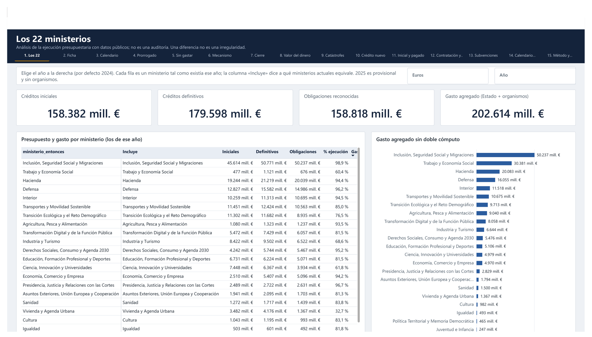

### 2. Ficha de un ministerio

Del presupuesto inicial a las obligaciones, capítulos, ingresos de los organismos y contratación (se elige el ministerio).

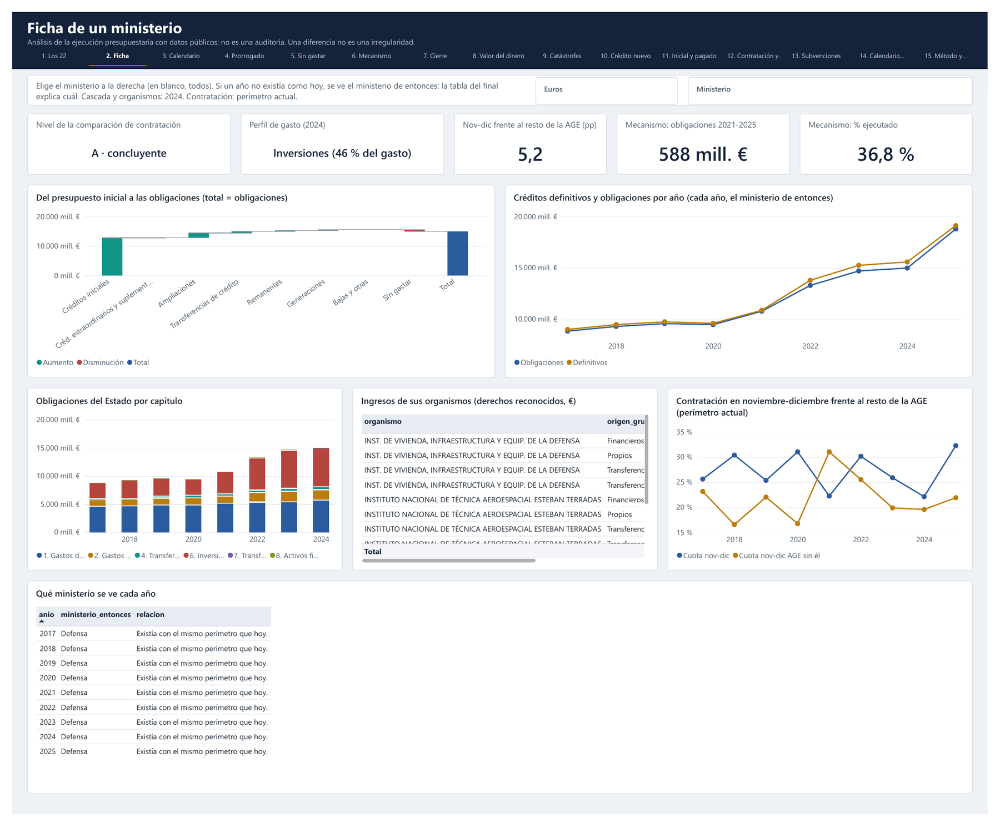

### 3. Calendario de prórroga

Días de cada año con presupuesto prorrogado y con el Gobierno en funciones.

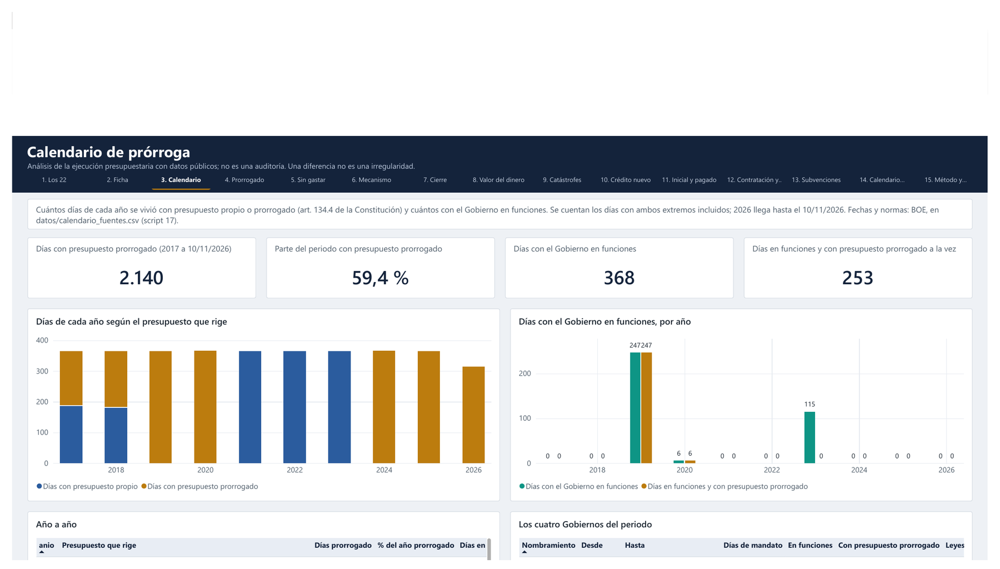

### 4. Presupuesto prorrogado

Ejecución de 2024 y 2025 sobre créditos iniciales y modificaciones de crédito en 2025.

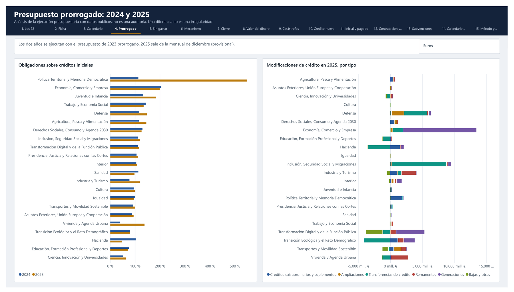

### 5. Lo que no se gasta

Crédito definitivo menos obligaciones, por capítulo y por ministerio.

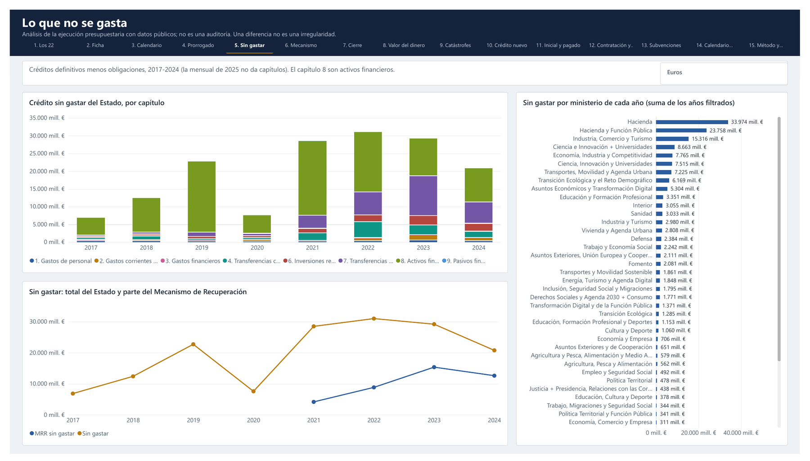

### 6. Mecanismo de Recuperación

Obligaciones del Mecanismo 2021-2025, peso en cada ministerio y programas.

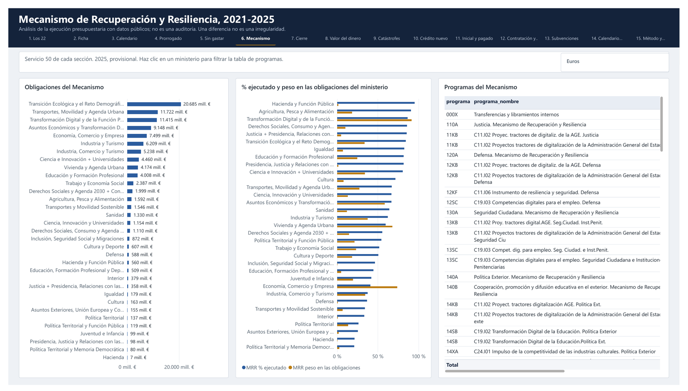

### 7. Contratación al cierre del ejercicio

Diferencia entre la cuota de noviembre-diciembre de cada ministerio y la del resto de la AGE.

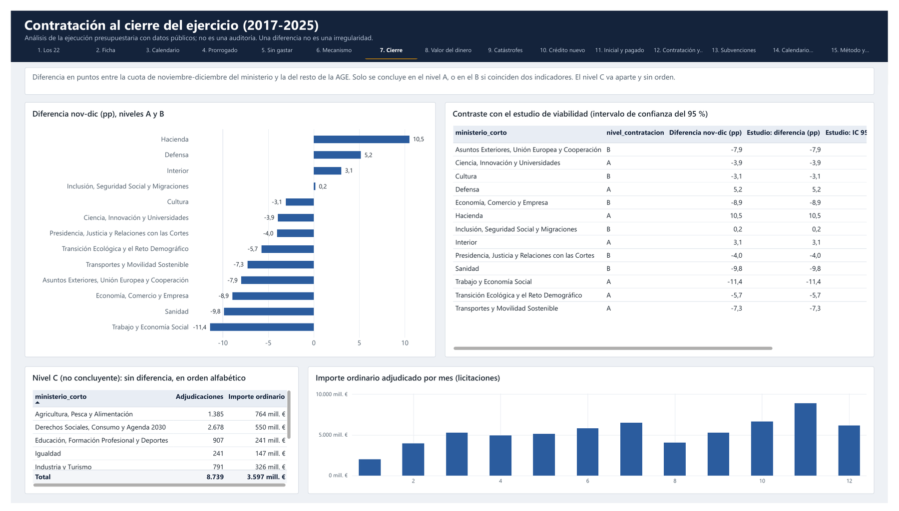

### 8. Valor del dinero

Euros corrientes y constantes de 2025 (IPC, deflactor del PIB y del consumo público).

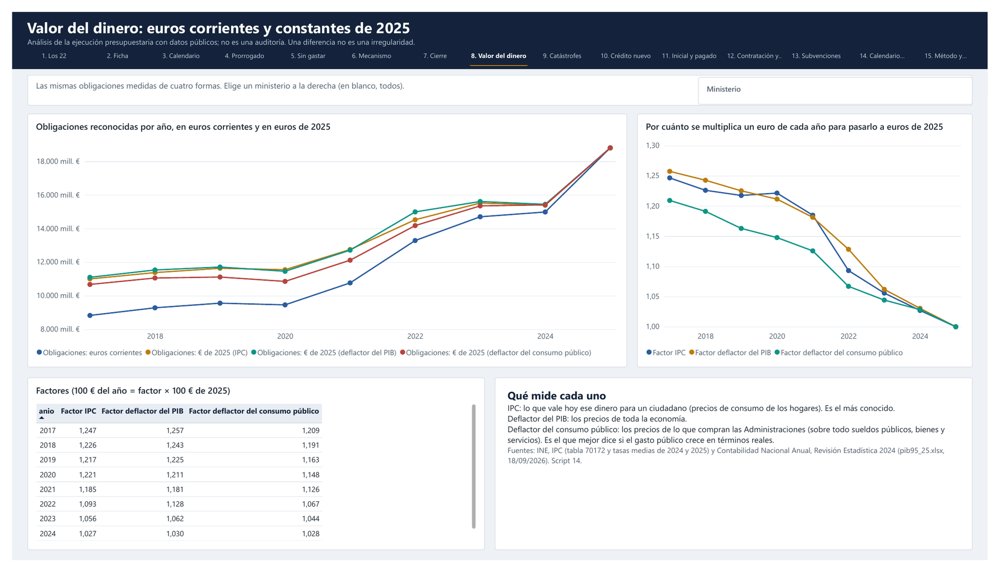

### 9. Respuesta a las catástrofes

Líneas de crédito de covid-19, crisis de la energía, DANA, La Palma y Filomena.

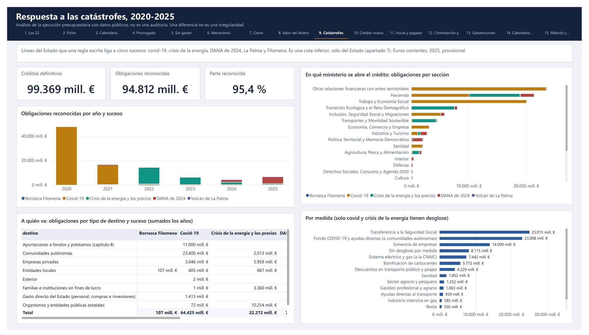

### 10. Crédito nuevo y remanentes

Crédito del presupuesto frente a crédito creado durante el año, y remanentes.

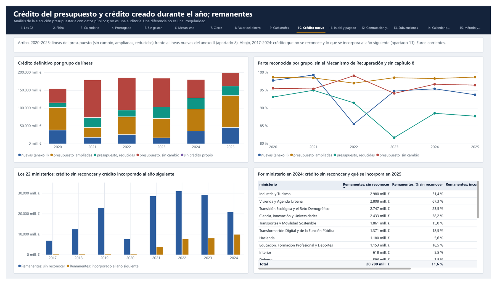

### 11. Del crédito inicial al pagado

Obligaciones sobre créditos iniciales y obligaciones sin pagar a 31 de diciembre.

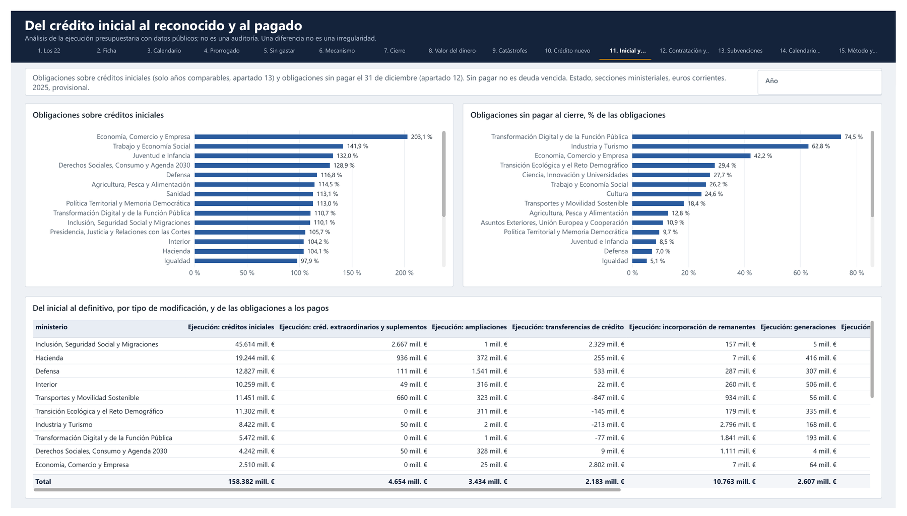

### 12. Contratación frente a gasto

Qué parte del gasto agregado pasa por contratos y concentración por líneas.

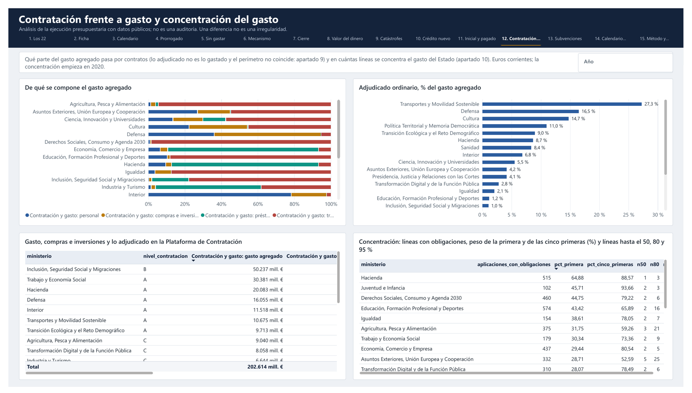

### 13. Subvenciones (BDNS)

Ayudas concedidas por instrumento y ministerio, 2022-2025, solo agregados.

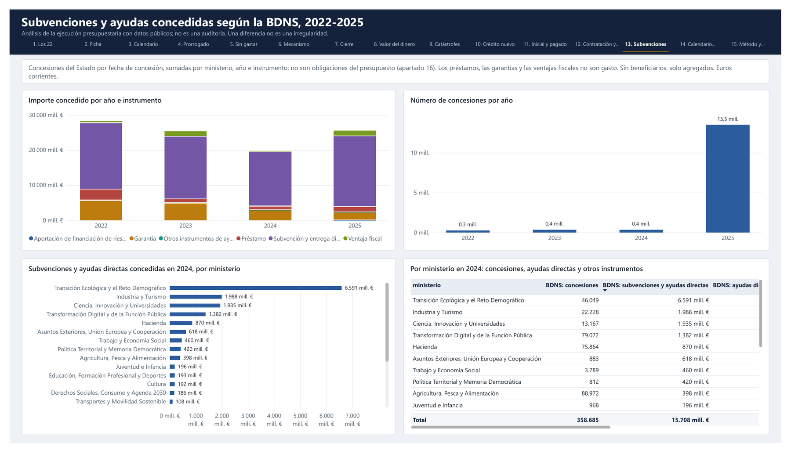

### 14. Calendario mensual

Obligaciones acumuladas mes a mes, 2024 y 2025.

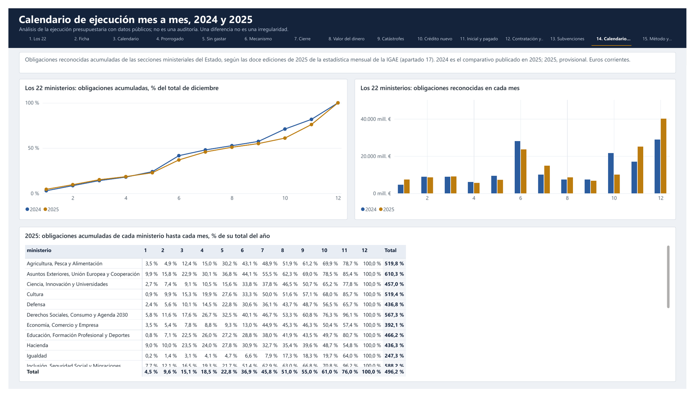

### 15. Método y registro

Perímetro, doble cómputo, años comparables, euros constantes y avisos.

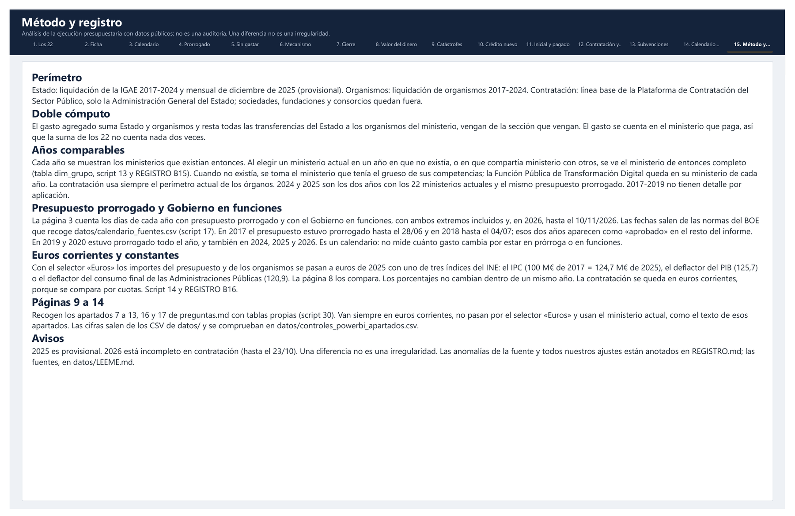

## Registro

[`REGISTRO.md`](REGISTRO.md) separa lo que viene así en las fuentes (anotado tal cual), los ajustes e interpretaciones nuestras y los errores nuestros corregidos. Reasignar una cifra es criterio nuestro: no significa que la fuente esté mal.

## Cómo se reproduce

```
python scripts/01_leer_liquidacion.py        # liquidación del Estado (PDF) -> datos/liquidacion_*.csv
python scripts/03_leer_mensual.py            # mensual de diciembre del último año -> datos/mensual_secciones.csv
python scripts/02_equivalencias_y_cuadro.py  # equivalencias de secciones y ministerio actual
python scripts/04_leer_organismos.py         # liquidación de organismos (Excel) -> datos/organismos_*.csv
python scripts/05_organismos_ministerio.py   # cada organismo a su ministerio actual
python scripts/06_transferencias_estado.py   # transferencias Estado <-> organismos y aportación al mutualismo
python scripts/07_fichas.py                  # datos/ficha_*.csv (22 ministerios)
python scripts/09_contratacion.py            # contratación por ministerio (línea base del proyecto de Defensa)
python scripts/16_contratacion_centralizada.py  # compras centralizadas en la serie de Hacienda (registros del proyecto de Defensa)
python scripts/17_calendario_presupuestos.py   # calendario de la prórroga: días por año y por Gobierno (datos/calendario_*.csv y comparativa.md); admite una fecha de corte AAAA-MM-DD
python scripts/10_mecanismo_recuperacion.py  # Mecanismo de Recuperación por sección y programa, 2021-2025
python scripts/18_catastrofes.py             # respuesta a las catástrofes 2020-2025 (datos/catastrofes_*.csv y preguntas.md, apartado 7)
python scripts/19_credito_nuevo.py           # crédito del presupuesto frente a crédito creado durante el año (datos/credito_nuevo_*.csv y preguntas.md, apartado 8); usa el script 18
python scripts/20_contratacion_gasto.py      # contratación frente a gasto por ministerio (datos/contratacion_gasto.csv y preguntas.md, apartado 9); después del 07, el 09 y el 11
python scripts/21_concentracion.py           # concentración del gasto por aplicaciones (datos/concentracion_ministerio.csv y preguntas.md, apartado 10); usa el script 18
python scripts/22_remanentes.py              # remanentes incorporados, crédito anulado y bajas (datos/remanentes_ministerio.csv y preguntas.md, apartado 11)
python scripts/23_pendiente_pago.py          # reconocido y sin pagar al cierre (datos/pendiente_pago_*.csv y preguntas.md, apartado 12)
python scripts/24_sobre_inicial.py           # obligaciones sobre créditos iniciales (datos/sobre_inicial_*.csv y preguntas.md, apartado 13)
python scripts/26_euros_constantes.py        # obligaciones en euros constantes de 2025 (datos/euros_constantes_*.csv y preguntas.md, apartado 14); necesita powerbi/deflactor.csv (script 14)
python scripts/25_vista_entonces.py          # ministerio actual frente al de entonces en las preguntas 7 y 9 (datos/vista_entonces_*.csv y preguntas.md, apartado 15); después del 13, el 24 y el 26
python scripts/27_bdns.py                    # subvenciones y ayudas concedidas según la BDNS, 2022-2025 (datos/bdns_*.csv y preguntas.md, apartado 16); lee fuentes/bdns/bdns_agregados.json; después del 18
python scripts/28_mensual_2025.py              # calendario de ejecución mes a mes en 2024 y 2025 (datos/mensual_*.csv y preguntas.md, apartado 17); lee fuentes/igae/mensual/mensual_01-25.pdf … mensual_12-25.pdf; después del 18
python scripts/31_transferencias_ccaa.py   # transferencias a comunidades autónomas (artículos 45 y 75) mes a mes en 2025 (datos/transferencias_ccaa_*.csv y preguntas.md, apartado 18); lee las doce ediciones mensuales de 2025; después del 18 y del 28
python scripts/29_organos_centrales.py <ruta registros/sector_publico>   # comprobación de compras centralizadas (datos/contratacion_organos_principales.csv); lee los registros de la PLACSP del proyecto Gasto Defensa, que no se publican
python scripts/11_comparativa.py             # comparativa de los 22 (datos/comparativa_*.csv y comparativa.md)
python scripts/12_powerbi.py                 # tablas del modelo de Power BI (powerbi/; guía en powerbi/MODELO.md)
python scripts/13_grupos_historicos.py       # ministerio de entonces de cada año (powerbi/dim_grupo.csv)
python scripts/14_deflactor.py               # IPC y deflactores del INE (powerbi/deflactor.csv)
python scripts/30_powerbi_apartados.py       # tablas de los apartados 7 a 13, 16 y 17 para Power BI (powerbi/fact_*.csv; datos/controles_powerbi_apartados.csv)
python scripts/15_informe_powerbi.py         # modelo semántico y 15 páginas del informe (powerbi/*.pbip)
python scripts/15b_validar_informe.py powerbi <json-schemas> <powerbi-desktop-samples>   # opcional: valida el informe contra los esquemas de Microsoft (hay que clonar esos dos repositorios)
python scripts/08_fichas_md.py               # tablas de fichas/*.md
```

Necesita Python 3 y `openpyxl`. Los PDF y Excel de la IGAE (liquidación del Presupuesto del Estado y de organismos, estadísticas mensuales de 2025; unos 220 MB) no se publican en el repositorio: se descargan de la web de la IGAE (Intervención General de la Administración del Estado, ejecución presupuestaria) y se colocan en `fuentes/igae/` con la misma estructura (`liquidacion_estado/`, `liquidacion_estado_excel/`, `liquidacion_organismos/`, `organismos_excel/` y `mensual/`). El texto de los PDF se extrae a `fuentes/igae/_texto/` con `pdftotext` (Poppler). Los scripts 16 y 29 leen además los registros de licitaciones de la PLACSP del proyecto de Defensa (`registros/sector_publico/`, gigas de datos que no se publican); el resto de la contratación sale de `fuentes/contratacion/linea_base_cierre.csv`, que sí está.

## Licencia

[MIT](LICENSE). Los datos proceden de fuentes públicas (IGAE, SEPG, PLACSP, BDNS, INE), cada una con sus propias condiciones de reutilización; se citan en [`datos/LEEME.md`](datos/LEEME.md).

## Autor

[DeLabFuente](https://github.com/DeLabFuente) · Analista de datos (IBM Data Analyst; preparando el PL-300). Proyecto personal de análisis de datos abiertos; no representa la posición de ninguna institución.
